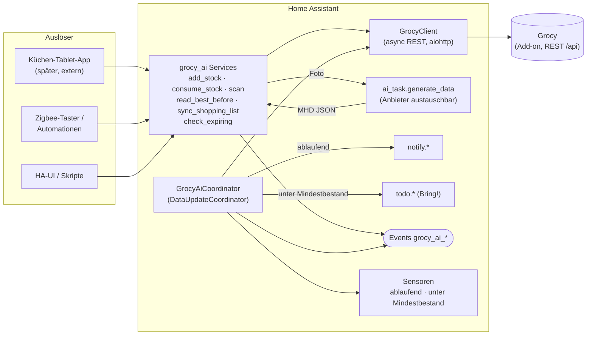

# PLAN – ha-grocy-ai (`grocy_ai`)

> Referenzdokument. Wird bei jeder Änderung an Architektur, Schnittstelle oder
> Meilensteinen aktualisiert. Aufgaben-Checkliste: [TODO.md](TODO.md).

## 1. Ziel

Eine Home-Assistant-Custom-Integration (HACS Custom Repository), die Grocy um
KI-Funktionen und Automatisierung erweitert. **Grocy bleibt die Datenbasis.**

1. **Bestand per Barcode buchen** – „Plus“ (eingekauft, +X) und „Minus“
   (verbraucht, −X). Unbekannte Barcodes werden bei „Plus“ automatisch über
   Grocys Barcode-Lookup (Open Food Facts) als Produkt angelegt (abschaltbar).
2. **MHD per Foto** (optional pro Buchung) – Foto → KI liest MHD (ggf.
   Produktname/Menge) → Buchung mit echtem MHD. Über HA **AI Task**
   (`ai_task.generate_data` mit Anhang + strukturierter Ausgabe), damit der
   KI-Anbieter austauschbar bleibt. Ohne Foto: Grocys Standard-Haltbarkeit des
   Produkts bzw. „läuft nie ab“.
3. **Benachrichtigungen** bei bald ablaufenden Produkten (Vorlauf in Tagen +
   Notify-Dienst im Options-Flow).
4. **Mindestbestand → Bring!** – Produkte unter Mindestbestand/leer landen
   automatisch auf der einstellbaren To-do-Entität, ohne Duplikate.
5. **Saubere Services/Events**, damit später ein Küchen-Tablet (eigene App,
   nicht Teil des Projekts) oder Zigbee-Taster andocken können.

**Nicht im Scope:** Android-Tablet-App, eigene Hardware, Ersatz von Grocy.

## 2. Umgebung (Stand 2026-10-25)

| Thema | Wert |
|---|---|
| Home Assistant | 2026.10.x, HA OS auf Raspberry Pi, Sprache `de` |
| AI Task | eine AI-Task-Entität vorhanden – `generate_data` unterstützt Attachments + `structure` |
| To-do-Listen | mehrere, darunter Bring!-Listen (konkrete Entitäten nur lokal in `.local/ENVIRONMENT.md`) |
| Grocy | Community-Add-on `a0d7b954_grocy` (installiert 2026-10-25), intern `http://a0d7b954-grocy` (Port 80); Netzwerk-Port 9192 gesetzt (nötig für Direktzugriff) |
| Grocy-HACS-Integration | im HACS-Store aktuell als `iamkarlson/grocy` gelistet; wird von `grocy_ai` **nicht** benötigt |
| Test-Toolchain | `pytest-homeassistant-custom-component` 0.13.374 → HA 2026.10.3, **Python ≥ 3.14** |

## 3. Architektur

### Module (Zielbild)

| Datei | Aufgabe |
|---|---|
| `__init__.py` | Setup/Unload des Config-Entries, Services registrieren (`async_setup`) |
| `config_flow.py` | Config-Flow (Grocy-URL, API-Key, SSL) + Options-Flow (Vorlauf, Notify, To-do, AI-Task) |
| `api.py` | `GrocyClient` – dünner async-Wrapper um die Grocy-REST-API |
| `coordinator.py` | Pollt Grocy (`/stock/volatile`), triggert Benachrichtigung + Bring!-Sync |
| `services.py` | Service-Handler + Schemas |
| `ai.py` | MHD-Erkennung via `ai_task.generate_data` |
| `shopping.py` | Bring!-/To-do-Abgleich ohne Duplikate |
| `sensor.py` | Zählsensoren (ablaufend, abgelaufen, unter Mindestbestand) |
| `const.py` | Konstanten, Event-Namen, Options-Keys |
| `photos.py` | Foto-Upload `/api/grocy_ai/photo` (nur angemeldet) + flüchtiger Speicher im RAM |
| `media_source.py` | Medienquelle `media-source://grocy_ai/<id>` → liefert hochgeladene Fotos als Temp-Datei an AI Task |
| `frontend/grocy-ai-panel.js` | Seitenleisten-Seite „Grocy AI“ fürs Handy (Web Component ohne Build) |

## 4. Datenfluss

### 4.1 Plus-Buchung mit Foto
1. Auslöser ruft `grocy_ai.add_stock` mit `barcode`, `amount`, optional `image`.
2. `GrocyClient.get_product_by_barcode(barcode)` bzw. `get_product(id)` →
   Produktdetails. Grocy antwortet bei unbekanntem Barcode mit **400** →
   (Option an, nur bei Plus) `GET /api/stock/barcodes/external-lookup/{barcode}?add=true`
   → Grocy fragt Open Food Facts und legt das Produkt an → Event
   `grocy_ai_product_created`, Buchung läuft weiter. Nichts gefunden/Plugin-
   Fehler → Event `grocy_ai_barcode_unknown`, `ServiceValidationError`.
3. Wenn `best_before_date` übergeben → direkt verwenden (`manual`). Sonst wenn
   `image` → `ai_task.generate_data` (Anhang = Media-Source-ID, Struktur
   `{best_before_date, product_name, confidence}`, AI-Task-Entität aus den
   Optionen, leer = HA-Standard) → Datum parsen (`YYYY-MM-DD`, `YYYY-MM`,
   `TT.MM.JJ(JJ)`, `MM/JJ(JJ)`; Monat ohne Tag → Monatsende) → prüfen:
   `confidence ≥ 0.5`, Datum zwischen heute − 30 Tage und heute + 15 Jahre →
   Quelle `ai`. Bei jedem Fehler (kein AI Task, unlesbar, unsicher, unplausibel)
   **wird trotzdem gebucht** mit Standard-Haltbarkeit; Antwortfeld `ai_error`
   + Event `grocy_ai_best_before_failed`.
4. Sonst berechnet **grocy_ai** das Datum selbst (Grocys API würde ohne Datum
   *heute* setzen; die Standard-Haltbarkeit wendet nur die Grocy-UI an):
   `default_best_before_days > 0` → heute + Tage (`default`); `-1` →
   `2999-12-31` (`never`); `0`/leer → `2999-12-31` (`unset`, damit keine
   Fehlalarme entstehen; Tablet kann nachfragen).
5. `POST /api/stock/products/{id}/add` (`transaction_type: purchase`), danach
   `GET /api/stock/products/{id}` für den neuen Bestand.
6. Event `grocy_ai_stock_added` (später: Coordinator-Refresh).

### 4.2 Minus-Buchung
`grocy_ai.consume_stock` → `POST /api/stock/products/by-barcode/{barcode}/consume`
(`amount`, `spoiled`) → Event `grocy_ai_stock_consumed` → Refresh. Bestand 0 →
Grocy meldet Fehler → Event `grocy_ai_error`, Service-Fehler mit klarem Text.

### 4.3 Periodisch (Coordinator, Standard alle 15 min)
- `GET /api/stock/volatile?due_soon_days=N` → `due_products`,
  `overdue_products`, `expired_products`, `missing_products`.
- Ablaufend: einmal täglich zur eingestellten Uhrzeit Sammel-Benachrichtigung
  über den gewählten Notify-Dienst + je Produkt Event `grocy_ai_product_expiring`.
- Mindestbestand: `missing_products` (Grocy liefert hier Produkte unter
  `min_stock_amount`) → Abgleich mit offenen Einträgen der To-do-Entität →
  nur fehlende hinzufügen (`todo.add_item`).

### 4.4 Duplikat-Vermeidung Bring!
- Vergleich normalisiert (lowercase, getrimmt) gegen alle Einträge mit Status
  `needs_action` (`todo.get_items`).
- Zusätzlich merkt sich die Integration (HA `Store`) welche Produkte sie selbst
  hinzugefügt hat; ein Produkt wird erst wieder hinzugefügt, nachdem es einmal
  über Mindestbestand war (verhindert Re-Add, wenn jemand den Eintrag manuell
  abhakt, aber noch nicht eingebucht hat).

## 5. Schnittstelle (Services & Events)

Stabile Schnittstelle für Tablet-App und Taster. Änderungen = SemVer-Minor
(neu) bzw. -Major (inkompatibel). Alle Services akzeptieren entweder
`barcode` **oder** `product_id`. Bei mehreren Config-Entries optional
`config_entry_id`.

### Services

| Service | Felder | Antwort (`response`) |
|---|---|---|
| `grocy_ai.add_stock` ✅ v0.2.0 | `barcode`/`product_id` (genau eins), `amount` (Std. 1, > 0), `best_before_date` (opt.), `price` (opt.), `location_id` (opt.), `config_entry_id` (opt.); `image` (opt., ab v0.4.0) | `{product_id, product_name, barcode, amount, best_before_date, best_before_source: manual\|default\|never\|unset (ab M3: ai), stock_amount, product_created, ai_confidence\|ai_error}` |
| `grocy_ai.consume_stock` ✅ v0.2.0 | `barcode`/`product_id` (genau eins), `amount` (Std. 1), `spoiled` (Std. false), `config_entry_id` (opt.) | `{product_id, product_name, barcode, amount, spoiled, stock_amount}` |
| `grocy_ai.scan` ✅ v0.2.0 | `barcode`, `mode: plus\|minus`, `amount`, `config_entry_id` (opt.); `image` (opt., ab v0.4.0) | wie add/consume – Komfort-Service für Taster/Tablet |
| `grocy_ai.read_best_before` ✅ v0.4.0 | `image` (Media-Selector), `config_entry_id` (opt.) | `{recognized: true, best_before_date, product_name, confidence}` bzw. `{recognized: false, best_before_date: null, reason}` – nur Erkennung, keine Buchung |
| `grocy_ai.read_barcode` ✅ v0.5.0 | `image`, `config_entry_id` (opt.) | `{recognized: true, barcode}` bzw. `{recognized: false, barcode: null, reason}` (`no_barcode`, `invalid_barcode`, `low_confidence`, …) – nur GTIN mit gültiger Prüfziffer |
| `grocy_ai.sync_shopping_list` | – | `{added: [...], skipped: [...]}` |
| `grocy_ai.check_expiring` | `days` (opt.), `notify` (Std. true) | `{expiring: [...], expired: [...]}` |

### Events

| Event | Daten |
|---|---|
| `grocy_ai_stock_added` | `product_id, product_name, barcode, amount, best_before_date, best_before_source, stock_amount` |
| `grocy_ai_stock_consumed` | `product_id, product_name, barcode, amount, spoiled, stock_amount` |
| `grocy_ai_barcode_unknown` | `barcode, mode` (Tablet kann Produkt-Anlage anbieten) |
| `grocy_ai_product_created` ✅ v0.3.0 | `product_id, product_name, barcode` (per Open-Food-Facts-Lookup angelegt) |
| `grocy_ai_best_before_failed` ✅ v0.4.0 | `product_id, barcode, reason` (`ai_task_unavailable`, `ai_task_failed: …`, `no_structured_result`, `no_date`, `low_confidence`, `implausible_date`, ab v0.5.2 `ai_overloaded`) |
| `grocy_ai_product_expiring` | `product_id, product_name, best_before_date, days_left` |
| `grocy_ai_shopping_item_added` | `product_id, product_name, todo_entity_id` |
| `grocy_ai_error` | `service, message` |

### Entitäten (ab M4)
`sensor.grocy_ai_expiring_products`, `sensor.grocy_ai_expired_products`,
`sensor.grocy_ai_missing_products` (Zustand = Anzahl, Attribut = Liste).

## 6. Entscheidungen

| # | Entscheidung | Begründung |
|---|---|---|
| D1 | **Direkte Grocy-REST-API** (eigener `GrocyClient` mit HAs geteilter `aiohttp`-Session) statt `pygrocy`/`pygrocy2` | `pygrocy` ist synchron (`requests`) → Executor nötig; Original-`pygrocy` ist seit Jahren unverändert, `pygrocy2` ist ein Fork. Wir brauchen nur ~8 Endpunkte. Eine eigene PyPI-Abhängigkeit kann mit der Grocy-HACS-Integration kollidieren (gleiches Paket, andere Version → HA installiert nur eine). Direkt-REST = async, keine Abhängigkeit, volle Kontrolle (z. B. `by-barcode`-Endpunkte, `best_before_date`). |
| D2 | **Kein Abhängigkeitszwang zur Grocy-HACS-Integration** | Wir sprechen Grocy selbst an; die Grocy-Integration kann parallel laufen (Sensoren/Chores), muss aber nicht. |
| D3 | **AI über `ai_task.generate_data`** mit `structure` + `attachments` | Anbieter austauschbar, keine KI-Keys in unserer Integration. AI-Task-Entität im Options-Flow wählbar (leer = HA-Standard). |
| D4 | Bilder als **Media-Source-ID** (`media_content_id`, z. B. `media-source://camera/camera.x` oder `media-source://image_upload/...`) | Das ist genau das Format, das `ai_task` für Attachments erwartet; Tablet kann per Image-Upload liefern. |
| D5 | Services domain-weit in `async_setup` registrieren | HA-Konvention (Quality Scale „action-setup“); Services existieren auch wenn Grocy gerade offline ist. |
| D6 | Secrets nur im Config-Entry (`api_key`), Diagnostik redacted | Projektregel; nichts im Repo. |
| D7 | Konfig: Verbindung im Config-Flow, Verhalten (Vorlauf, Notify, To-do, AI-Task, Uhrzeit) im **Options-Flow** | Verhalten ist änderbar ohne Neueinrichtung. |
| D8 | Mindest-HA **2026.10.0**, Tests mit Python 3.14 | Entspricht `pytest-homeassistant-custom-component` und der installierten HA-Version. |
| D9 | Releases: Tag `vX.Y.Z` → Action prüft `manifest.json`-Version == Tag → GitHub-Release mit Notes aus CHANGELOG | Smartphone-Workflow: Release in GitHub, Update in HACS. HACS lädt den Tag; zusätzlich `grocy_ai.zip` als Asset für manuelle Installation (D13). |
| D10 | `iot_class: local_polling`, `integration_type: service` | Grocy lokal, wird gepollt; kein physisches Gerät. |
| D11 | Git-Autor im Repo: `RatchetGK <163332573+RatchetGK@users.noreply.github.com>` (repo-lokal) | Kein globaler Git-Name gesetzt; noreply-Adresse schützt die echte E-Mail. |
| D12 | Lizenz MIT | Standard für HACS-Integrationen. |
| D13 | **Repo öffentlich, Historie neu gestartet** (2026-10-25) | HACS braucht ein dauerhaft öffentliches Repo. Das zwischenzeitlich private Repo enthielt private Angaben (interne IP, Vornamen in Entitäts-IDs) in alten Commits; auf GitHub lassen sich alte Commits nicht sicher entfernen → altes Repo in `ha-grocy-ai-old` umbenannt (privat), neues öffentliches Repo mit einem sauberen Initial-Commit. Release enthält zusätzlich `grocy_ai.zip`. |
| D16 | **MHD-Erkennung blockiert nie die Buchung**; Schwelle `confidence ≥ 0.5`, plausibel = heute − 30 Tage … heute + 15 Jahre; Monat ohne Tag = Monatsende; manuelles MHD hat Vorrang vor Foto | Ein Einkauf soll immer gebucht werden; ein falsch erkanntes Datum ist schlimmer als die Standard-Haltbarkeit; Monatsende entspricht der Bedeutung von „MHD 12/2026“. |
| D17 | **Handy-Seite als eigenes Sidebar-Panel** (Web Component, kein Build) statt Dashboard-Karte; Fotos per Live-Kamera (`getUserMedia`, nur HTTPS) mit Auslöser, Barcode live per `BarcodeDetector`; Fallback `<input type=file>` (Companion-App ignoriert `capture` → nur Galerie), auf dem Handy auf 1600 px verkleinert, Upload an eigenen HTTP-Endpunkt, Weitergabe an AI Task über eigene Medienquelle; Fotos im RAM (max. 10, 10 min, nach KI-Abfrage gelöscht; für die Dauer der KI-Abfrage als Temp-Datei, weil `ai_task` in 2026.10 nur lokale Dateien liest). Barcode zuerst per Browser-`BarcodeDetector`, sonst AI Task mit Prüfziffer-Check | Upload über den Media-Selector ist am Handy umständlich; `getUserMedia` ist der einzige Weg, in der Companion-App direkt die Kamera zu öffnen (braucht sicheren Kontext = HTTPS); keine Fotos dauerhaft auf der Platte/in den Medien (Privatsphäre); der native Scanner der Companion-App ist für Custom-Panels nicht nutzbar (Listener nur intern im Frontend). |
| D18 | **KI-Überlast (503/429) wird zweimal wiederholt** (nach 2 s und 5 s), danach Grund `ai_overloaded`. Die Handy-Seite liest das MHD **direkt nach dem Foto** (`read_best_before`) und bucht dann mit `best_before_date` | Google meldet zeitweise „high demand“; der Nutzer soll das Datum vor dem Buchen sehen/korrigieren und bei KI-Fehlern nicht doppelt buchen. |
| D15 | **Unbekannte Barcodes über Grocys eingebauten Barcode-Lookup** (`external-lookup?add=true`, Plugin Open Food Facts) statt eigenem OFF-Client; Option `external_barcode_lookup` (Std. an), nur bei Plus | Kostenlos, kein Key; nutzt Grocys Produkt-Voreinstellungen (Lagerort/Einheit) wie die Grocy-UI; keine zusätzliche Abhängigkeit; Minus darf nie Produkte anlegen. |
| D14 | **Datenschutz-Schutzschichten**: Skill `commit-push`, Git-Hooks (`.githooks`: pre-commit, commit-msg, pre-push) mit `scripts/check_private_data.py`, untracked Denylist `.local/private-terms.txt`, CI-Job „Secrets & private data“ (Skript + gitleaks) | Öffentliches Repo: Secrets/private Daten dürfen nie committet werden; mehrere unabhängige Prüfungen vor Commit, vor Push und nach Push. |

## 7. Meilensteine & Abnahmekriterien

### M1 – Gerüst & CI (v0.1.0) ✅ erledigt 2026-10-25
- Repo mit `hacs.json`, `manifest.json`, Integration mit Config-Flow
  (URL, API-Key, SSL; Verbindungstest gegen `/api/system/info`) + Options-Flow.
- Actions: hassfest + HACS-Validierung bei jedem Push; ruff + pytest; Release
  bei Tag.
- **Abnahme:** alle Actions grün, Release `v0.1.0` existiert, Integration
  erscheint nach HACS-Installation in „Integration hinzufügen“.
- **Ergebnis:** Actions grün (hassfest, HACS-Struktur, ruff, pytest 9/9),
  Release v0.1.0 mit `grocy_ai.zip` (neu erstellt im öffentlichen Repo, D13).
  HACS-Installation in HA steht noch aus.

### M2 – Grocy-Anbindung & Barcode-Buchung (v0.2.0) ✅ abgenommen 2026-10-29
- `GrocyClient` (Produkt per Barcode, add, consume, volatile), Fehlerklassen.
- Services `add_stock`, `consume_stock`, `scan` + Events.
- **Abnahme:** Mit installiertem Grocy: Plus/Minus per Service in den
  Entwicklerwerkzeugen ändert Bestand in Grocy; unbekannter Barcode feuert
  `grocy_ai_barcode_unknown`; Tests mit gemockter API.
- **Ergebnis:** Services + Events umgesetzt, 24 Tests grün. Fehler sind
  übersetzt (de/en) und feuern `grocy_ai_error`.

### M2b – Barcode-Lookup Open Food Facts (v0.3.0) ✅ abgenommen 2026-10-29
- Unbekannter Barcode bei Plus → Grocy legt Produkt via Open Food Facts an → Buchung.
- **Abnahme:** Neuer, in Grocy unbekannter Barcode einer Markenpackung wird per
  `scan` (plus) angelegt und gebucht; Option aus → kein Lookup.

### M3 – MHD per Foto (v0.4.0) ✅ umgesetzt 2026-10-29 (Live-Abnahme offen)
- `read_best_before` + `image` in `add_stock`/`scan` über `ai_task`.
- Plausibilitätsprüfung + Fallback auf Grocy-Standard.
- **Abnahme:** Foto eines MHD-Aufdrucks (Kamera-Snapshot/Upload) → korrektes
  Datum in Grocy; unlesbares Foto → Fallback + Event.
- **Ergebnis:** `ai.py` + Service `read_best_before`, `image` in `add_stock`/`scan`,
  50 Tests grün (Parsing, Plausibilität, gemocktes `ai_task.generate_data`).

### M3b – Handy-Seite mit Kamera (v0.5.0) ✅ umgesetzt 2026-10-31 (Live-Abnahme offen)
- Sidebar-Panel, Foto-Upload, Medienquelle, `read_barcode`.
- **Abnahme:** Am Handy (Companion-App) Barcode und MHD per Kamera → Buchung in Grocy mit `best_before_source: ai`.

### M4 – Ablauf-Benachrichtigungen & Sensoren (v0.6.0)
- Coordinator, Sensoren, tägliche Benachrichtigung, `check_expiring`.
- **Abnahme:** Produkt mit MHD in < N Tagen → genau eine Benachrichtigung pro
  Tag auf dem gewählten Notify-Dienst.

### M5 – Bring!-Sync (v0.7.0)
- Mindestbestand/leer → To-do-Entität, ohne Duplikate, Store für Zustand.
- **Abnahme:** Produkt unter Mindestbestand erscheint genau einmal auf Bring!;
  wiederholte Läufe erzeugen keine Duplikate.

### M6 – Härtung (v1.0.0)
- Diagnostics, Reauth-Flow, Repair-Issues bei Grocy offline, Übersetzungen
  de/en vollständig, Doku für Tablet-Entwickler, Quality-Scale-Check.
- **Abnahme:** 2 Wochen Alltagsbetrieb ohne Fehler im Log.

## 8. Risiken / offene Punkte

| Risiko / Frage | Umgang |
|---|---|
| Private Daten/Secrets landen versehentlich im öffentlichen Repo. | D14; bei Leck: Schlüssel sofort widerrufen, nicht nur aus Historie löschen. |
| Frischer Klon ohne `.local/private-terms.txt` / ohne `core.hooksPath`. | Skill `commit-push` Schritt 1 prüft beides. |
| Grocy-Add-on aktiviert den Direktzugriff (Port 80) **nur**, wenn im Add-on ein Netzwerk-Port gesetzt ist; sonst nur Ingress → „Verbindung fehlgeschlagen“. | Port gesetzt (9192); Hinweis im Config-Flow-Text und README. |
| KI liest MHD falsch (Formate „31.12.26“, „12/2026“, nur Monat/Jahr). | Prompt mit Formatregeln, Monats-Datum → letzter Tag des Monats, Plausibilitätsprüfung, `confidence` im Ergebnis, Fallback. |
| Bring!-Artikelnamen weichen von Grocy-Namen ab (Duplikat mit anderem Wortlaut). | Normalisierter Vergleich + eigener Store; später optional Mapping-Feld/Grocy-Userfield. |
| Barcode-Packungsgrößen (`product_barcodes.amount`) und Tara-Gewicht werden noch nicht berücksichtigt – `amount` ist immer in der Bestandseinheit. | Bei Bedarf in M6 ergänzen (Grocy-UI-Verhalten nachbauen). |
| Unbekannte Barcodes (Produkt fehlt in Grocy). | Seit v0.3.0 Anlage über Open Food Facts; sonst Event für Tablet. |
| Per Open Food Facts angelegte Produkte: Name evtl. unpassend/fremdsprachig, keine Standard-Haltbarkeit (→ „läuft nie ab“), kein Mindestbestand; Lagerort/Einheit aus Grocy-Voreinstellungen, sonst erster vorhandener Eintrag. | Nutzer ergänzt in Grocy; `product_created` in Antwort/Event erlaubt Nachfrage am Tablet. |
| `pytest-homeassistant-custom-component` läuft unter Windows nur eingeschränkt. | Tests lokal via `uv` + Python 3.14 versuchen; maßgeblich ist CI (Linux). |
| HACS-Validierung „brands“ verlangt Eintrag im home-assistant/brands-Repo. | Check in CI ignoriert (`ignore: brands`); für Custom Repository nicht nötig. |
| `hacs/action` validiert keine privaten Repos. | Repo ist öffentlich; Ersatz-Job „HACS structure“ greift nur, falls es je wieder privat wird. |
| Zwei Grocy-Integrationen gleichzeitig (iamkarlson/grocy + grocy_ai). | Keine geteilten Abhängigkeiten (D1/D2) → kein Konflikt. |
